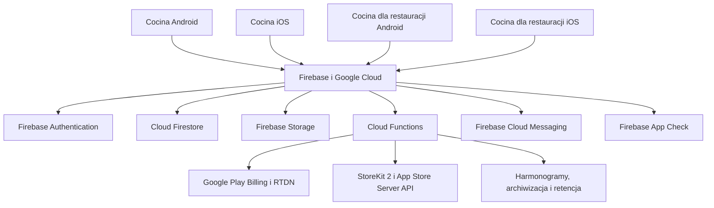
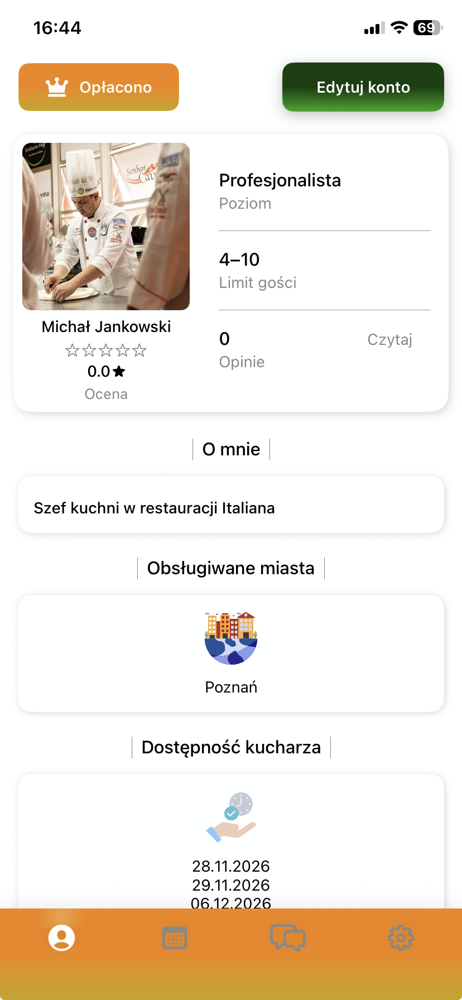

# Cocina — Mobile App Ecosystem

  <strong>Natywny ekosystem aplikacji mobilnych na Androida i iOS, łączący funkcje społecznościowe, kulinarne i usługowe.</strong>

  Android · iOS · Kotlin · Swift · Firebase · Google Cloud

> Kod źródłowy pozostaje prywatny ze względu na komercyjny charakter projektu. To repozytorium prezentuje Cocina jako techniczne i produktowe case study.

---

## O projekcie

Cocina to rozwijany przeze mnie ekosystem dwóch produktów mobilnych:

- **Cocina** — aplikacja społecznościowo-kulinarna dla użytkowników;
- **Cocina dla restauracji** — panel mobilny do publikowania stolików, sprzedaży cateringu i obsługi gości.

Każdy produkt posiada natywne aplikacje na Androida i iOS. Wspólny backend oparty na Firebase i Google Cloud obsługuje uwierzytelnianie, dane, multimedia, komunikację, powiadomienia, operacje zaufane oraz synchronizację płatności i subskrypcji.

Projekt obejmuje cały cykl powstawania produktu: analizę i UX, implementację aplikacji, backend, bezpieczeństwo, testy, optymalizację oraz przygotowanie wydań do Google Play i App Store.

---

## Ekosystem w skrócie

| Obszar | Cocina | Cocina dla restauracji |
|---|---|---|
| Odbiorca | użytkownik, uczestnik wydarzeń, klient, szef kuchni | właściciel lub pracownik restauracji |
| Cel | nowe znajomości i odkrywanie kulinarnych doświadczeń | publikacja ofert i sprawna obsługa gości |
| Główne moduły | wydarzenia, stoliki, mapa, love/friends (spotkania 1 na 1), przepisy, prywatni szefowie, czaty, catering, książki kulinarne | profil lokalu, stoliki, goście, catering, zamówienia, harmonogram, subskrypcja |
| Platformy | Android i iOS | Android i iOS |
| Backend | Firebase i Google Cloud | Firebase i Google Cloud |

---

## Cocina

Cocina łączy funkcje społecznościowe, kulinarne i marketplace w jednej aplikacji. Użytkownik może znaleźć spotkanie, stworzyć własne wydarzenie, umówić się do restauracji, poznać osobę o podobnych zainteresowaniach, zamówić catering albo skorzystać z usług prywatnego szefa kuchni.

### Wydarzenia i wspólne gotowanie

- tworzenie wydarzeń domowych i miejskich;
- wyszukiwanie wydarzeń w pobliżu na liście oraz mapie;
- dołączanie do wydarzeń i kontrola limitu uczestników;
- prezentowanie gospodarza, terminu, lokalizacji i programu spotkania;
- grupowy czat wydarzenia;
- historia udziału, potwierdzanie obecności, oceny i zgłoszenia;
- powiadomienia związane ze zmianami oraz aktywnością uczestników.

### Stoliki restauracyjne

- przeglądanie dostępnych stolików według miasta, lokalizacji i terminu;
- widok listy oraz interaktywna mapa ofert;
- wybór terminu i rezerwacja miejsca przy stoliku wraz z innymi użytkownikami;
- prezentowanie liczby dostępnych miejsc, zdjęć i danych restauracji;
- historia rezerwacji oraz ocena doświadczenia po spotkaniu;
- synchronizacja listy gości z aplikacją restauracyjną.

### Dopasowania LOVE i FRIENDS

- ankieta preferencji i cel spotkania: randka lub nowe przyjaźnie;
- wyliczanie zgodności na podstawie odpowiedzi ankietowych i przeglądanie dopasowanych profili;
- świadome zaakceptowanie albo odrzucenie propozycji;
- czat uruchamiany dla dopasowanych użytkowników;

### Przepisy i społeczność

- dodawanie oraz odkrywanie przepisów innych użytkowników;
- prezentowanie składników, etapów przygotowania i zdjęć;
- filtrowanie i wyszukiwanie treści;
- zapisywanie ulubionych materiałów;
- oceny i interakcje społecznościowe.

### Prywatny szef kuchni

- profile szefów z opisem doświadczenia, obsługiwanymi miastami i opiniami;
- publikowanie lub przeglądanie zleceń na prywatne wydarzenia;
- szczegóły terminu, menu, liczby gości, obowiązków i ceny;
- komunikacja Klient–Szef w dedykowanym czacie;
- historia realizacji oraz oceny po zakończeniu usługi;
- każdy użytkownik może świadczyć usługę szefa w dedykowanym profilu szefa (wymagana osobna subskrypcja);
- każdy użytkownik może być klientem, czyli zamówić usługę prywatnego szefa do obsługi własnej imprezy zgodnie z preferencjami;
- aplikacja umożliwia rezerwację, właściwa płatność uzgadniana między klientem a szefem.

### Catering

- przeglądanie pakietów wielu restauracji;
- wybór liczby pakietów i łączenie wariantów w jednym zamówieniu;
- koszyk i czytelne podsumowanie kosztów;
- odbiór osobisty albo dostawa;
- walidacja adresu i zasięgu dostawy;
- wybór terminu realizacji zgodnie z wymaganym wyprzedzeniem;
- historia zamówień, statusy, oceny i obsługa anulowania.
- aplikacja umożliwia rezerwację, właściwa płatność uzgadniana między klientem a restauracją.

### Komunikacja

Wspólny system czatów obsługuje rozmowy wydarzeń (tylko dla uczestników danego wydarzenia), dopasowania love/friends (między 2 osobami które polubiły się nawzajem) oraz relację Klient–Szef (dla konkretnej rezerwacji). Wiadomości są grupowane w czytelne stosy, pokazują autora i zdjęcie uczestnika, a podglądy uczestników są przechowywane przy konwersacji, aby ograniczyć dodatkowe odczyty.

---

## Cocina dla restauracji

Osobna aplikacja biznesowa umożliwia restauracjom publikowanie ofert i obsługę procesów widocznych w Cocina:

- rejestracja oraz konfiguracja profilu restauracji;
- galeria zdjęć, menu, dane kontaktowe i informacje o lokalu;
- publikowanie pojedynczych lub wielu stolików jednocześnie (do maksymalnie 20);
- terminy, liczba miejsc, zasady rezerwacji i zniżki dla dostępnych stolików;
- lista gości oraz potwierdzanie obecności;
- tworzenie i zarządzanie pakietami cateringowymi;
- warianty pakietów, zapasy, odbiór osobisty i zasięg dostawy;
- aktywne i historyczne zamówienia;
- harmonogram stolików i cateringów;
- powiadomienia operacyjne;
- abonamenty Google Play i App Store;
- bezpłatny okres próbny i program dostępu dla wczesnych testerów.

---

## Przykładowe przepływy

### Wydarzenie

Użytkownik odkrywa wydarzenie → sprawdza gospodarza i szczegóły → dołącza → rozmawia na czacie → uczestniczy → potwierdza obecność i wystawia ocenę.

### Stolik

Restauracja publikuje termin → oferta pojawia się na mapie i liście → użytkownicy zajmują miejsca → restauracja obsługuje listę gości → stolik trafia do historii.

### Catering

Restauracja publikuje pakiety → użytkownik buduje koszyk → wybiera sposób realizacji i termin → backend waliduje zamówienie → restauracja realizuje zamówienie → użytkownik może ocenić usługę.

### LOVE/FRIENDS

Użytkownik wypełnia ankietę → otrzymuje dopasowania → wybiera profil → po wzajemnym dopasowaniu rozpoczyna rozmowę.

---

## Moja rola

Samodzielnie odpowiadam za projektowanie, implementację i rozwój ekosystemu, w tym za:

- architekturę natywnych aplikacji Android i iOS;
- projektowanie interfejsów i doświadczenia użytkownika;
- logikę biznesową oraz integracje między aplikacjami;
- backend, Cloud Functions i model danych Firestore;
- reguły bezpieczeństwa Firebase;
- uwierzytelnianie oraz Firebase App Check;
- płatności, subskrypcje i wspólne uprawnienia między platformami;
- powiadomienia push i obsługę zdarzeń serwerowych;
- archiwizację, retencję i anonimizację danych;
- optymalizację odczytów, obrazów i list;
- testy funkcjonalne i bezpieczeństwa;
- konfigurację Google Play Console i App Store Connect;
- przygotowanie aplikacji do testów oraz publikacji.

---

## Technologie

| Warstwa | Technologie |
|---|---|
| Android | Kotlin, Android SDK, XML, ViewBinding, ViewModel, LiveData, Coroutines, RecyclerView, ListAdapter, DiffUtil, Glide, Lottie |
| iOS | Swift, SwiftUI, UIKit, Swift Concurrency, StoreKit 2, Lottie, kontrolowany cache obrazów |
| Backend | Firebase Authentication, Cloud Firestore, Cloud Functions, Firebase Storage, Firebase Cloud Messaging, Crashlytics, Node.js |
| Bezpieczeństwo | Firebase App Check, Play Integrity, App Attest, DeviceCheck, Secret Manager |
| Płatności | Google Play Billing, RTDN, StoreKit 2, App Store Server API, App Store Server Notifications |
| Publikacja i testy | Google Play Console, App Store Connect, TestFlight, zamknięte testy Google Play, MobSF |

---

## Architektura

Aplikacje klienckie odpowiadają za interfejs, lokalny stan i bezpieczne przesyłanie żądań. Operacje wymagające zaufania — między innymi weryfikacja zakupów, przyznawanie uprawnień, potwierdzanie operacji właścicielskich, usuwanie kont i archiwizacja — są wykonywane po stronie backendu.

---

## Bezpieczeństwo i prywatność

W projekcie zastosowałem:

- Firebase App Check z Play Integrity na Androidzie oraz App Attest i DeviceCheck na iOS;
- kontrolę uwierzytelnienia, ról i własności zasobów po stronie backendu;
- brak bezpośredniego zapisu pól rozliczeniowych przez aplikację kliencką;
- serwerową weryfikację transakcji Google Play i App Store;
- przechowywanie sekretów poza kodem aplikacji;
- ograniczone klucze Google API;
- ochronę przed ponownym wykorzystaniem bezpłatnego okresu próbnego;
- idempotencję operacji, które mogą zostać dostarczone ponownie;
- atomowe aktualizacje i transakcje Firestore;
- walidację własności restauracji, ofert i zamówień;
- narzędzia zgłaszania, blokowania i moderacji treści;
- kontrolowaną retencję oraz anonimizację danych historycznych;
- R8 i resource shrinking w produkcyjnych wydaniach Androida;
- statyczną analizę aplikacji za pomocą MobSF.

Dane historyczne są zachowywane tylko w zakresie potrzebnym do prezentowania historii, ocen, obsługi zgłoszeń, bezpieczeństwa i wymaganych procesów biznesowych.

---

## Subskrypcje i płatności

Ekosystem rozróżnia uprawnienia użytkownika oraz abonament restauracji. Zakupy są inicjowane w Google Play lub App Store, a ich wynik jest weryfikowany i synchronizowany przez backend.

Zaimplementowane mechanizmy obejmują:

- plany okresowe i bezpłatne okresy próbne;
- serwerową kwalifikację do triala;
- weryfikację transakcji, odnowień i anulowań;
- przywracanie zakupów;
- synchronizację przez RTDN i App Store Server Notifications;
- wspólne uprawnienie widoczne na Androidzie i iOS;
- zarządzanie zakupem przez konto sklepu, które zrealizowało transakcję;
- program dostępu dla uczestników wczesnych testów;
- automatyczne ograniczenie funkcji lub ofert po wygaśnięciu dostępu.

---

## Wydajność

- paginacja zapytań Firestore i stopniowe ładowanie list;
- ograniczanie liczby pobieranych dokumentów oraz pól;
- współdzielone modele stanu i kontrolowany cykl życia listenerów;
- ListAdapter i DiffUtil na Androidzie;
- zmniejszanie oraz kompresowanie zdjęć przed wysłaniem;
- pamięciowy i dyskowy cache obrazów;
- lekkie podglądy uczestników przechowywane przy konwersacjach;
- zachowywanie instancji głównych ekranów;
- wyłączony trwały cache dokumentów z danymi klientów na współdzielonych urządzeniach restauracji.

---

## Urządzenia i dostępność

Interfejsy zostały przygotowane dla:

- telefonów w orientacji pionowej (Cocina);
- telefonów w orientacji pionowej i poziomej oraz dla tabletów w orientacji pionowej i poziomej (Cocina dla restauracji);
- różnych proporcji ekranów i bezpiecznych obszarów systemowych;
- adaptacyjnych siatek oraz kontrolowanej szerokości treści.

---

## Jakość i testowanie

- osobne środowiska Debug/Staging i Production;
- testy jednostkowe logiki backendowej;
- testy reguł dostępu i uprawnień;
- konta sandbox Google Play i App Store;
- testerzy licencji Google Play;
- TestFlight i zamknięte testy Google Play;
- Firebase App Check Debug Provider;
- testy telefonów, tabletów i orientacji;
- testy zakupu, odnowienia, anulowania oraz przywracania subskrypcji;
- analiza statyczna i bezpieczeństwa z wykorzystaniem MobSF.

---

## Wybrane wyzwania techniczne

### Wspólne uprawnienia między platformami

Ten sam użytkownik lub restauracja może korzystać z Androida i iOS. Backend przechowuje wspólny status dostępu, ale zarządzanie transakcją pozostaje przypisane do sklepu i konta, które dokonało zakupu.

### Spójność miejsc i zamówień

Dołączanie do wydarzeń, rezerwowanie miejsc i zmiana stanów magazynowych wymagają ochrony przed wyścigami. Operacje krytyczne są walidowane serwerowo i wykonywane atomowo.

### Historia i audyt obecności

Zakończone wydarzenia i stoliki nie znikają bez śladu. Dane potrzebne do historii, ocen i zgłoszeń trafiają do kontrolowanej warstwy archiwalnej, a dane zbędne są usuwane lub anonimizowane.

### Koszt odczytów i szybkość czatów

Listy, profile i czaty korzystają z paginacji, ograniczonych zapytań oraz lekkich podglądów danych. Pozwala to pokazywać autora wiadomości i uczestników bez wielokrotnego pobierania pełnych profili.

### Bezpieczne usuwanie kont

Proces uwzględnia przyszłe wydarzenia, aktywne zamówienia, subskrypcje i dane historyczne potrzebne do obsługi zgłoszeń. Zależnie od rodzaju danych wykonywane jest usunięcie, odłączenie albo anonimizacja.

---

## Zrzuty ekranów

### Cocina — społeczność i odkrywanie

  
  
  

### Cocina — relacje i komunikacja

  
  
  

### Cocina — usługi i catering

  
  
  

### Cocina dla restauracji

  
  
  

  
  
  

---

## Dostępność aplikacji

Linki zostaną uzupełnione wraz z udostępnianiem kolejnych wydań:

- Cocina — Google Play: **w przygotowaniu**
- Cocina — App Store: **w przygotowaniu**
- Cocina dla restauracji — Google Play: **w przygotowaniu**
- Cocina dla restauracji — App Store: **w przygotowaniu**
- Strona projektu: [cocinapps.pl](https://www.cocinapps.pl/)

---

## Status projektu

Cocina jest aktywnie rozwijanym projektem przechodzącym kolejne etapy testów, optymalizacji i publikacji.

Planowane kierunki rozwoju:

- dalszy rozwój funkcji społecznościowych i systemu dopasowań;
- rozbudowa ocen restauracji, szefów i cateringów;
- narzędzia analityczne dla restauracji;
- dalsza automatyzacja testów i procesów publikacji;
- rozszerzenie systemu powiadomień;
- dostępność na kolejnych rynkach.

---

## Kod źródłowy

Kod produkcyjny, konfiguracja infrastruktury i reguły bezpieczeństwa znajdują się w prywatnych repozytoriach.

---

## Autor

**Oskar Januszewski**

Mobile Developer tworzący natywne aplikacje Android i iOS oraz backend Firebase — od pomysłu i interfejsu, przez logikę biznesową i płatności, po bezpieczeństwo, testy oraz publikację.

- GitHub: [oskarj10](https://github.com/oskarj10)
- LinkedIn: [Oskar Januszewski](https://www.linkedin.com/in/oskar-januszewski-08846344b/)
- Strona: [cocinapps.pl](https://www.cocinapps.pl/)

Po godzinach: podróże, gotowanie i sport.
